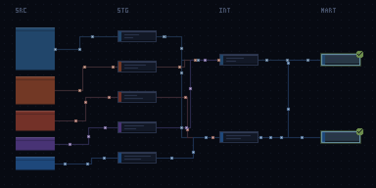
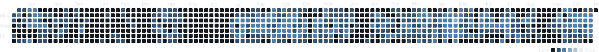

<!--START_SECTION:cover-->
<!--END_SECTION:cover-->

<picture>
  <source media="(prefers-color-scheme: dark)"
          srcset="https://readme-typing-svg.demolab.com?font=Inconsolata&weight=500&size=50&duration=1500&pause=50&color=FFFFFF&multiline=false&repeat=false&width=1200&height=80&lines=I+think+i+write+too+much+sql+%C2%AF%5C_%28%E3%83%84%29_%2F%C2%AF">
  <source media="(prefers-color-scheme: light)"
          srcset="https://readme-typing-svg.demolab.com?font=Inconsolata&weight=500&size=50&duration=1500&pause=50&color=000000&multiline=false&repeat=false&width=1200&height=80&lines=I+think+i+write+too+much+sql+%C2%AF%5C_%28%E3%83%84%29_%2F%C2%AF">
  
</picture>

<!--START_SECTION:profile-->
<sub>The page mostly stands on its own, but the rice terraces take the profile from 06:00 to 08:00 Hanoi time and the Old Quarter from 18:00 to 20:00. This hour shows the Old Quarter.</sub>

<p align="center"></p>

Phố Commit is a street in Hanoi's Old Quarter that grows with my GitHub activity: 4,579 contributions in the last year. Each tube house is one of my repos, and the busier I am in it, the taller it gets: `quickdbd-cli` is 6 floors after 233 commits this year. I haven't merged a pull request yet this year, so the road is quiet for now. The phở cart is serving my latest post from The Analytics Engineer's Handbook, [I let a coding agent build my dashboard. I didn't let it touch the math.](https://markphammm.substack.com/p/i-let-a-coding-agent-build-my-dashboard), and is waiting for its first order. Nobody has parked here this month yet, so the best spot on the sidewalk is yours. The sky follows the time in Hanoi, where it's daytime right now.

<p align="center">
  <a href="https://github.com/MarkPhamm/MarkPhamm/issues/new?title=street%3A%20park&amp;body=Just%20hit%20Create.%20Your%20motorbike%20gets%20parked%20on%20Ph%E1%BB%91%20Commit%20with%20your%20username%20on%20the%20ticket%2C%20and%20it%20stays%20for%2030%20days.%20One%20visit%20per%20person%20per%20day%2C%20Hanoi%20time."></a>
  <a href="https://github.com/MarkPhamm/MarkPhamm/issues/new?title=street%3A%20pho&amp;body=Just%20hit%20Create.%20The%20cart%20serves%20you%20a%20bowl%20of%20ph%E1%BB%9F%20and%20the%20bowl%20counter%20on%20the%20street%20goes%20up%20by%20one.%20One%20visit%20per%20person%20per%20day%2C%20Hanoi%20time."></a>
</p>
<p align="center"><sub>Buttons open a pre-filled issue. Hit Create and the street updates in about a minute.</sub></p>

<details>
<summary>How Phố Commit works</summary>

- **Houses** are my 8 public repositories with the most commits this calendar year, from the GitHub GraphQL API. The red sign is the repo name and the blue house number is its commit count.
- **Floors** go up at 10, 25, 50, 100 and 200 commits, so a quiet repo still gets a one-storey house and the busiest ones top out at six.
- **Motorbikes** on the road are my most recently merged pull requests in public repos this year, with the PR number on the plate.
- **The phở cart** serves the newest post from The Analytics Engineer's Handbook, read from its RSS feed. Every "Order phở" issue adds a bowl to the counter.
- **Parked bikes** belong to visitors who opened a "Park a motorbike" issue in the last 30 days. Everyone gets one visit per day, Hanoi time.
- **The sky** follows the time in Hanoi: dawn, day, dusk or night. After dark the windows and lanterns light up.
- **No server.** A GitHub Action redraws the street four times a day and right after each visit, then commits one SVG to this repo. The code is in [`street/`](street).

</details>
<!--END_SECTION:profile-->

## 🧠 About Me 

<blockquote align="center">
  <b><i>"Analytics isn't just my job - it's my obsession. Scroll down and see for yourself"</i></b>
</blockquote>

<p align="center">
  
</p>

<p align="center">
  <a href="https://www.linkedin.com/in/minhbphamm/" target="_blank">
    
  </a>
  <a href="https://leetcode.com/u/markphammm/" target="_blank">
    
  </a>
  <a href="https://platform.stratascratch.com/user/SmartPersonality1862" target="_blank">
    
  </a>
</p>

<div align="center">
  <a href="https://wakatime.com/@894cf02a-9974-42d0-acde-603cdd98fe17"></a>
  
  
  
</div>

---

## 💼 Experience 

<table cellpadding="8">
  <tr>
    <td colspan="4"><b>Now</b></td>
  </tr>
  <tr>
    <td width="200">Aug 2026 –</td>
    <td width="220"><a href="https://infinitelambda.com/"><b>Infinite Lambda</b></a></td>
    <td>Senior Analytics Engineer</td>
    <td>Global data and AI consultancy</td>
  </tr>
  <tr>
    <td>Oct 2026 –</td>
    <td><b>Stealth Startup</b></td>
    <td>Founding Analytics Engineer</td>
    <td>AI learning and assessment platform</td>
  </tr>
  <tr>
    <td>May 2025 –</td>
    <td><a href="https://xomdata.com/"><b>Xóm Data</b></a></td>
    <td>Builder</td>
    <td>Vietnamese data learning platform</td>
  </tr>
  <tr>
    <td colspan="4"><b>Before</b></td>
  </tr>
  <tr>
    <td>May 2025 – Aug 2026</td>
    <td><a href="https://insurify.com/"><b>Insurify</b></a></td>
    <td>Analytics Engineer</td>
    <td>Insurance aggregator</td>
  </tr>
  <tr>
    <td>May 2024 – Aug 2024</td>
    <td><a href="https://www.lazard.com/"><b>Lazard</b></a></td>
    <td>Data Engineer</td>
    <td>Investment bank and asset manager</td>
  </tr>
  <tr>
    <td>Jan 2024 – May 2024</td>
    <td><a href="https://www.techsmith.com/"><b>TechSmith Corp</b></a></td>
    <td>BI Engineer</td>
    <td>Visual communication software</td>
  </tr>
  <tr>
    <td>Jan 2023 – May 2023</td>
    <td><a href="https://www.corning.com/"><b>Corning Inc.</b></a></td>
    <td>Data Analyst</td>
    <td>Glass and materials science</td>
  </tr>
  <tr>
    <td>May 2022 – Sep 2022</td>
    <td><a href="https://en.napas.com.vn/"><b>NAPAS</b></a></td>
    <td>Data Analyst</td>
    <td>National payment network</td>
  </tr>
  <tr>
    <td>May 2022 – Sep 2022</td>
    <td><a href="https://kpim.vn/"><b>KPIM</b></a></td>
    <td>Data Science</td>
    <td>Business intelligence consultancy</td>
  </tr>
</table>

---

## 🛠️ Techstack &amp; Ecosystem 

<div align="center">
  <h3>🛠️ Tech Stack &amp; Reference Logos</h3>
  <table width="100%">
    <tr>
      <td width="25%"><b>🏢 Data Warehouse</b></td>
      <td width="75%">
        
        
        
        
      </td>
    </tr>
    <tr>
      <td><b>🌊 Data Lakehouse</b></td>
      <td>
        
        
        
        
        
        
        
        
        
        
      </td>
    </tr>
    <tr>
      <td><b>🔄 Data Processing &amp; Transformation</b></td>
      <td>
        
        
        
        
        
        
        
        
        
      </td>
    </tr>
    <tr>
      <td><b>📥 Data Integration &amp; Reverse ETL</b></td>
      <td>
        
        
        
        
      </td>
    </tr>
    <tr>
      <td><b>⚙️ Orchestration</b></td>
      <td>
        
        
        
        
        
        
      </td>
    </tr>
    <tr>
      <td><b>📊 BI &amp; Analytics</b></td>
      <td>
        
        
        
        
        
        
        
        
        
        
        
        
      </td>
    </tr>
    <tr>
      <td><b>🚀 DevOps &amp; Cloud</b></td>
      <td>
        
        
        
        
        
        
        
        
        
        
        
        
      </td>
    </tr>
    <tr>
      <td><b>🤖 AI Tooling</b></td>
      <td>
        
        
        
        
      </td>
    </tr>
  </table>
</div>

## 📊 Stats 

### GitHub Stats

<div align="center">
  <table border="0" style="border-collapse: collapse; border: none;">
    <tr style="border: none;">
      <!-- Left: Contribution Cityscape (larger) -->
      <td width="58%" align="center" style="border: none; padding: 10px;" valign="middle">
        
      </td>
      <!-- Right: GitHub Stats on top, Top Languages below -->
      <td width="42%" align="center" style="border: none; padding: 10px;" valign="middle">
        
        <br /><br />
        
      </td>
    </tr>
  </table>
</div>


### Things I'm working on this week
<!--START_SECTION:waka-->

```txt
SQL                8 hrs 16 mins         ███████░░░░░░░░░░░░░░░░░░   28.12 %
Markdown           8 hrs 1 min           ██████▓░░░░░░░░░░░░░░░░░░   27.29 %
HTML               3 hrs 14 mins         ██▓░░░░░░░░░░░░░░░░░░░░░░   11.02 %
Text               2 hrs 29 mins         ██░░░░░░░░░░░░░░░░░░░░░░░   08.46 %
Python             1 hr 46 mins          █▓░░░░░░░░░░░░░░░░░░░░░░░   06.01 %
```

<!--END_SECTION:waka-->

<p align="center">
  
</p>
